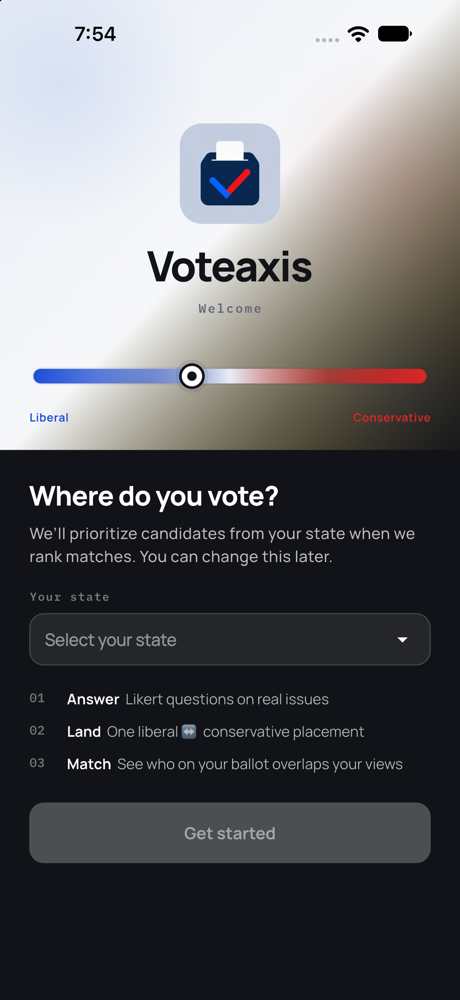
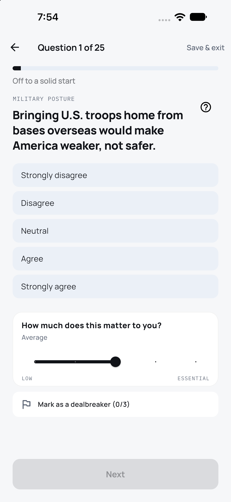
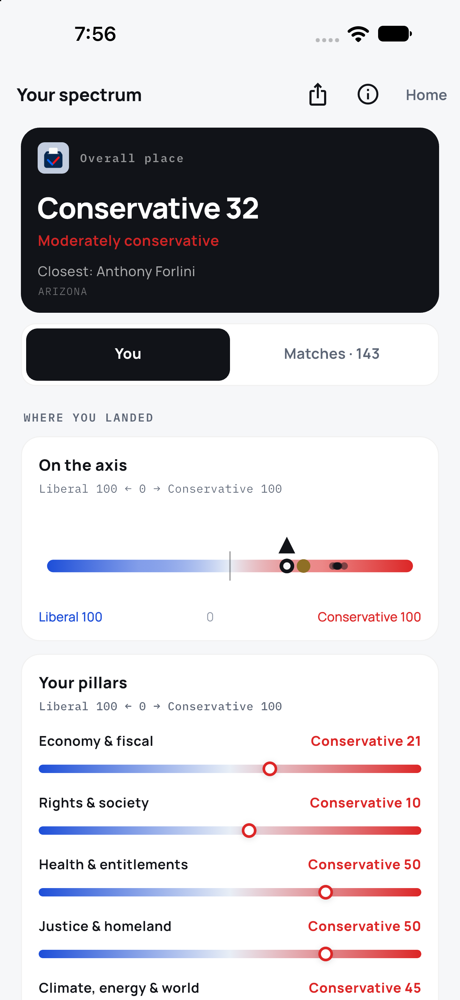
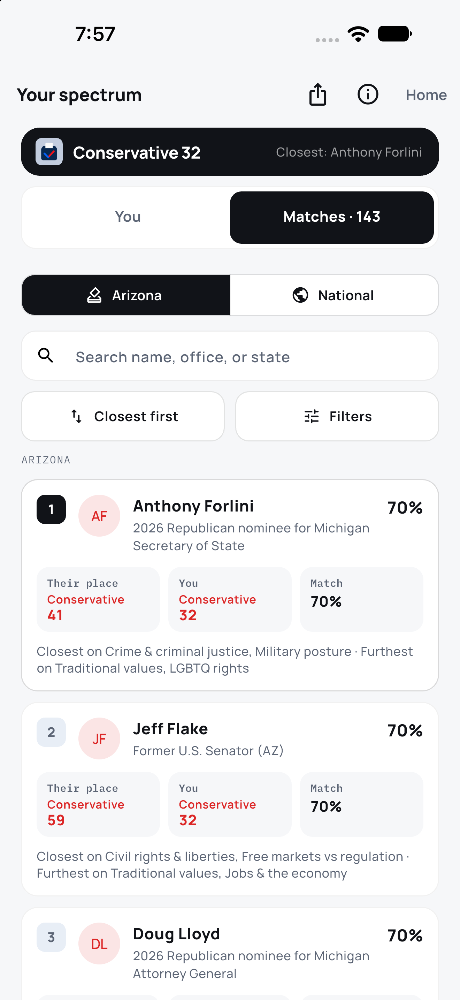
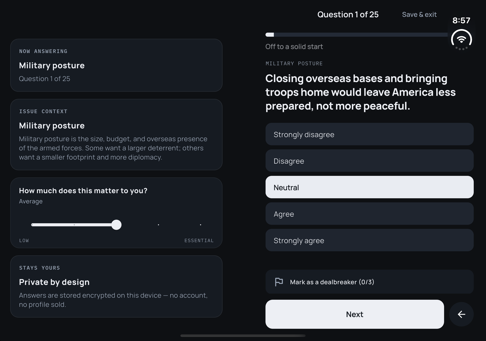

<p align="center">
  
</p>

<h1 align="center">Voteaxis</h1>

<p align="center">
  <b>See where you stand. Choose who to vote for.</b><br/>
  A short quiz places you on Liberal 100 ← 0 → Conservative 100, then ranks
  ballot candidates by how close they are to your issues.
</p>

<p align="center">
  <a href="https://voteaxis.org">Website</a> ·
  <a href="https://voteaxis.org/methodology">Methodology</a> ·
  <a href="https://voteaxis.org/privacy">Privacy</a> ·
  <a href="https://voteaxis.org/support">Support</a> ·
  <a href="https://api.voteaxis.org/health">API</a>
</p>

<p align="center">
  <a href="https://github.com/Greigh/Voteaxis/actions/workflows/ci.yml"></a>
  <a href="LICENSE"></a>
  
  
  <a href="https://api.voteaxis.org/health"></a>
</p>

<p align="center">
  
  
  
  
</p>

**Voteaxis** is a Greigh Studios product: take a short quiz on the issues that matter, land on a liberal↔conservative axis, and see which American presidents and political figures stand closest to you — and where you diverge.

The **quiz lives only on iOS and Android**. The website is the marketing, methodology, and waitlist surface — plus the page a shared result opens on.

**Status:** iOS on TestFlight (`1.0.0+4`), App Store submission in progress. Android next. Site and API live at [voteaxis.org](https://voteaxis.org) and [api.voteaxis.org](https://api.voteaxis.org/health).

> **Source available, not open source.** Everything in this repo is public so the scoring, the privacy claims, and the data behind the roster can be read and verified — but the code, brand, and curated catalogs remain proprietary. See [`LICENSE`](LICENSE).

## Why it’s worth a look

- **Honest scoring** — every figure and every answer sit on the same Liberal 100 ← 0 → Conservative 100 scale. No black box: the full method is public on the [methodology page](https://voteaxis.org/methodology) and in [`mobile/lib/`](mobile/lib/).
- **Private by design** — no account, no email, no analytics SDK. Answers are encrypted on-device; sharing is a QR or a 6-digit code you hand someone, and shared links are revocable and can be end-to-end encrypted (AES-GCM under a PBKDF2 key the server never sees).
- **A real ballot, not a vibe** — 738 figures across all 50 states: sitting officials, challengers, and historical figures, with Congress roll-call receipts blended in where the record exists.
- **Built for foldables** — first-class iPhone Duo support: the quiz opens like a book, context on one pane and answers on the other.

<p align="center">
  
</p>

<p align="center"><sub>Book pose on iPhone Duo — the rail leads left, the working column right.</sub></p>

## What’s in the repo

| Path | Role |
|------|------|
| [`mobile/`](mobile/) | Flutter app — quiz, SII scoring, rankings, politician detail, friend compare, share & transfer |
| [`server/`](server/) | Bun API for a VPS — friend codes, shared-result links, Issue of the Week, Congress receipts from BICAM (not scoring) |
| [`web/`](web/) | Next.js site — brand landing, interactive spectrum preview, methodology, waitlist, contribute, shared result pages |
| [`shared/`](shared/) | Cross-language fixtures — the encrypted-envelope interop vectors both Dart and WebCrypto must satisfy |
| [`scripts/`](scripts/) | Python/bash tooling — roll-call scoring, roster ingest, deploy |
| [`deploy/`](deploy/) · [`brand/`](brand/) | Server config samples and brand assets |
| [`docs/`](docs/) | Store changelogs, App Store screenshots, listing metadata |

Package READMEs: [`web/README.md`](web/README.md) · [`mobile/README.md`](mobile/README.md) · [`server/README.md`](server/README.md)

**Catalog (mobile)** — curated data in [`mobile/assets/data/`](mobile/assets/data/):

| File | Contents |
|------|----------|
| `politicians.json` | 738 figures (454 sitting, 284 former), covering all 50 states plus D.C. at a curated marquee tier — statewide officers, chamber leaders, notable Congress members, and historical figures — with issue vectors, office history, signature stances, and a confidence tag |
| `questions.json` | 81-item Likert bank (69 modern + 12 Progressive Era), each with a steel-man argument for the opposite stance |
| `issues.json` | 22 issues mapped to five pillars |
| `pillars.json` | Pillar labels |
| `rollcall_scores.json` | VoteView overlay — lifetime issue blend plus per-Congress coordinates for 115 members |

Figures span presidents, U.S. senators and representatives, governors, statewide constitutional officers, and state legislators. Only sitting members of Congress with a bioguide id carry Congress receipts, and the roll-call overlay covers 115 of them.

## Spectrum Issue Index (SII) v1

Our scoring method — not a third-party ideology score.

1. **Quiz** — five-point Likert answers, plus how important each question is (Low → Essential)  
2. **Issues** — each answer maps to an issue score on Liberal 100 ← 0 → Conservative 100  
3. **Pillars** — importance-weighted issue averages into five pillars  
4. **Axis** — importance-weighted issue average → overall placement (Liberal 100 ← 0 → Conservative 100)  
5. **Match** — politicians ranked by weighted issue overlap, with agree/disagree highlights, dealbreaker flags, and confidence tags  

**Pillars:** Economy & fiscal · Rights & society · Health & entitlements · Justice & homeland · Climate, energy & world  

In-app Methodology and [`web/app/methodology`](web/app/methodology) explain the same story for users.

## Product shape right now

### Mobile app

**Getting placed**

- Onboarding (~3 minutes framing)  
- Quiz with save/resume, per-question importance, and up to three dealbreakers  
- Quiz length is a setting — Short (12), Standard (25), or Long (40) items drawn from the 81-question bank  
- **Skip the quiz** — hand-set your placement on the axis, optionally pillar by pillar. Produces the same profile shape, so matching, sharing, and compare all keep working  

**Results**

- Spectrum placement, five-pillar bars, Active ballot / Historical matches, ranked list  
- Filters by office (all · presidents · governor · Senate · House · state Senate · state House) and by party  
- **Polar opposite** — flip the list to furthest-from-you  
- Politician pages: closeness %, match story, side-by-side issues, pillar breakdown, stance cards with source notes, office history, and Congress receipts (sponsored / cosponsored) for members with a bioguide id  
- **Steel man cards** — flip any issue row to the strongest case for the opposite stance  

**Sharing and moving**

- Compare with a friend — 6-digit code or QR, via the VPS API; shared axis, side-by-side issues, and an alignment Venn  
- Compare saved runs and browse run history  
- Share card (ballot match + historical match + voteaxis.org)  
- **Share & transfer** — publish a revocable `voteaxis.org/result/<id>` link, optionally password-protected end to end (AES-GCM under a PBKDF2 key sealed on-device; the server stores bytes it cannot read). Take the link down at any time  
- **Offline transfer code** — the whole placement plus every preference packed into ~80 bytes as one `VX1…` base-32 string. Moving to a new phone needs no account, no file picker, and no server  

**Settings**

- How far back to match: 2000s plus · 1980s plus · 1960s plus (the earliest tier also mixes in the 12 Progressive Era quiz items)  
- Time-blind matching — hide years and ordinals on the match list  
- Home state → “Your ballot”  
- Dealbreaker prompts, haptics, reduce motion  
- Issue of the Day widget — Agree/Disagree on the home or lock screen nudges one SII issue in the background (one per calendar day; does not replace the quiz)  
- Weekly reminder — a local notification pointing at the Issue of the Week; permission is only asked when the toggle is turned on  
- **iPhone Duo** — fold-aware layouts on `duo_fold`: book pose opens the app like a book (context rail on one pane, working column on the other), propped pose shows a glance card above the crease, on-table pose stacks them, closed pose uses the cover display. Settings → iPhone Duo toggles book split and the glance card  
- Discard an in-progress quiz, or delete everything  

Quiz answers never leave the device. Friend codes and shared links carry issue scores only — never Likert answers, email, or a device id.

### Marketing site

- Brand-first landing with animated, draggable spectrum preview  
- Methodology page  
- **Shared result pages** at `/result/<id>` — password-protected links are decrypted in the reader’s browser, and the page is `noindex` and never cached  
- Waitlist (local JSONL + optional self-hosted SMTP / webhook), with teacher / newsroom checkboxes  
- Contribute page — $5 / $15 / $30 one-time and a $25/year Sustainer via Stripe Checkout; nothing unlocks, the civic loop stays free  
- SEO + AI discovery: `/llms.txt`, sitemap, robots, web manifest, OG image, JSON-LD  
- No in-browser quiz — CTAs point to launch access / waitlist  

### API

Endpoints live in [`server/README.md`](server/README.md). In short: `/v1/codes` (48-hour friend profiles), `/v1/results` (publish · read · revoke a shared link), `/v1/week`, the Congress surface (`/v1/congress`, `/v1/members/:bioguideId`, `/v1/bills/…`, `/v1/receipts/:bioguideId`), and `/v1/politicians` — the curated roster in `mobile/assets/data/politicians.json`, ours to serve rather than only bundled into the app. Everything is rate-limited per IP. The API never scores.

The app fetches `/v1/politicians` at launch to refresh its bundled roster (ETag-conditional, so an unchanged roster is a `304`, not a ~1.5 MB re-download) and caches the result on-device; it always has the bundled asset to fall back on offline or on a fresh install. The endpoint is gated — production authorizes a per-install Ed25519 device keypair registered through `/v1/device-tokens` and signed per request (see [`mobile/lib/services/device_token.dart`](mobile/lib/services/device_token.dart)); the server stores only the public key and timestamps. See [`mobile/lib/data/app_data.dart`](mobile/lib/data/app_data.dart) and [`mobile/lib/services/politicians_cache.dart`](mobile/lib/services/politicians_cache.dart).

## Quick start

Requires [Bun](https://bun.sh) and [Flutter](https://docs.flutter.dev/get-started/install).

```bash
bun run setup          # web deps + flutter pub get
bun run dev            # marketing site → http://localhost:3000
bun run ios            # Flutter on iOS (or bun run android)
bun run api            # local API → http://localhost:8787
bun run test           # server + web + flutter tests
bun run lint           # typecheck + web lint + flutter analyze
```

`bun run ios` / `bun run android` boot a simulator/emulator if one isn't already running, then `flutter run` to it; `bun run build` produces a release APK and an unsigned iOS build.

### Marketing site only

```bash
bun run dev
# or: cd web && bun install && bun run dev
```

Waitlist signups append to `web/data/waitlist.jsonl` (gitignored):

```bash
bun run waitlist:list
```

Optional production notify (see `web/.env.example`):

- `SMTP_HOST` → mails `MAIL_NOTIFY_TO` (default `hello@greighstudios.com`) through the VPS's own Postfix; see DEPLOY.md § Mail  
- or `WAITLIST_WEBHOOK_URL` → Zapier / Make / n8n  

Contribution checkout needs Stripe keys and a webhook secret — see `web/.env.example` and DEPLOY.md § Stripe webhook.

### Flutter app only

```bash
bun run ios          # or: bun run android
# or directly: cd mobile && flutter pub get && flutter run
```

Friend compare, shared links, and Congress receipts talk to the VPS API (`https://api.voteaxis.org` by default). ProPublica’s Congress API is retired; we run our own REST API indexed from [BICAM](https://bicam.net/) via `python3 server/scripts/sync_bicam.py` (`bun run api:sync`). Optional `CONGRESS_API_KEY` hydrates latest action and official summaries on the cards already shown — it does not rescore SII. Floor votes that blend into SII issue scores are precomputed with `bun run scores:rollcall` (VoteView tape, not DW-NOMINATE member scores).

```bash
VOTEAXIS_API_URL=http://127.0.0.1:8787 bun run ios
```

`/health` reports `congress: true` when `server/data/bicam-receipts.sqlite` exists (`bun run api:sync` builds it). The simulator cannot see production receipts until that file is on the VPS.

### Roll-call scoring

`bun run scores:rollcall` pulls the VoteView tape and writes the overlay at `mobile/assets/data/rollcall_scores.json`. Defaults work with no config. To widen the window after a new Congress seats, or to park the cache elsewhere, use either an env var or the matching flag — **the flag wins**, since each flag's default is what the env var sets:

| Env var | Flag | Default |
|---------|------|---------|
| `VOTEVIEW_CACHE` | `--cache` | `server/data/voteview-cache` (gitignored) |
| `VOTEVIEW_MIN_CONGRESS` | `--min-congress` | `117` |
| `VOTEVIEW_MAX_CONGRESS` | `--max-congress` | `119` |

```bash
VOTEVIEW_MAX_CONGRESS=120 bun run scores:rollcall     # env: applies to the run
python3 scripts/score_rollcalls.py --max-congress 120  # flag: identical result
bun run scores:test                                    # fixtures, no download
```

There is deliberately no `.env` for these. [`scripts/`](scripts/) is invoked directly by `python3` and loads no env file, so a `KEY=value` line in any `.env` would be silently ignored — pass them in the shell as above.

### Roster maintenance

| Script | Job |
|--------|-----|
| `python3 scripts/ingest_us_senators.py` | Fold the current Senate roster into `politicians.json`. Curated issue maps survive; new members land as `confidence: inferred` |
| `python3 scripts/attach_bioguide.py` | Attach Congress.gov bioguide ids so receipts load. Nominees and state legislators are left unmatched on purpose |
| `python3 scripts/sync_politicians.py` (`bun run sync:politicians`) | Copy `mobile/assets/data/politicians.json` to `server/data/politicians.json` so `/v1/politicians` serves it. Run after every roster edit, before `bun run deploy` |
| `python3 scripts/check_roster_staleness.py` (`bun run roster:check`) | Cross-check every senator/representative against the live congress-legislators roster — flags resignations, party/chamber/district drift, and missing bioguide ids. Congress seat changes only; still web-search governors, AGs, state legislators, and in-flight races by hand |

A weekly automated routine runs `roster:check`, verifies anything it flags against a fresh web search, and opens a PR with the fix — or reports the issue without touching the repo if it can't confirm a fact confidently. It never pushes to `main` directly.

## Deploy

```bash
bun run deploy              # both processes: check → back up → rsync → build on the box → pm2 restart → verify
bun run deploy:api          # or deploy:web
bun run deploy:rollback     # restore the newest backup
```

The deploy reads the repo-root `.env` (see [`.env.example`](.env.example)) and fails before it touches production rather than halfway through. It never rsyncs over `server/data/` — friend codes, the BICAM index, and the waitlist JSONL survive every deploy.

See [`DEPLOY.md`](DEPLOY.md) for the full VPS runbook (both processes under PM2 behind nginx, TLS, mail, Stripe webhook; a Caddy sample lives in [`deploy/`](deploy/)).

## License

[Source available](LICENSE), not open source — Greigh Studios Source
Available License 1.0. You can read, study, and run everything here for
personal evaluation and security research; production use, redistribution,
and the curated catalogs in `mobile/assets/data/` require written
permission. Contributions (Section 2(d)) are welcome.

## Contributing & security

Issues and pull requests on GitHub. For security reports — the envelope
crypto, device-key signing, or the API — email
[hello@greighstudios.com](mailto:hello@greighstudios.com) rather than
opening a public issue.

## Ownership

The Greigh Studios LLC · Spectrum Issue Index v1
